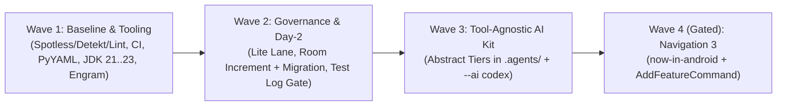

# Kickoff Reliability, Governance & AI-Kit Overhaul

*   **Author:** André (Kickoff-V2)
*   **Status:** Proposed
*   **Date:** 2026-11-12

--------------------------------------------------------------------------------

## Overview

Kickoff scaffolds multi-module Android App (`now-in-android`) and SDK (`android-sdk`) repositories, pairs them with Day-2 generators (`add feature`, `add module`, `add entity`), and synthesizes IDE-specific AI agent configurations from a `.agents/` Source of Truth. This design addresses verified defects and structural improvements in priority order across four waves: (1) green day-one `./gradlew check` and CI enforcement, accurate validator/JDK/setup tooling; (2) aligned Lite Lane governance, Room version increment on `add entity`, and saved test-log evidence for final approvals; (3) tool-agnostic abstract agent tiers and `--ai codex`; and (4) migrating `now-in-android` to AndroidX Navigation 3 (gated on toolchain compatibility).

## The Problem

1. **Broken day-one quality checks:** Fresh `app` and `sdk` scaffolds fail `./gradlew check` immediately (16 failing tasks in `app`, 7 in `sdk`) across Spotless/Ktlint, Detekt, and Android Lint. CI (`e2e-scaffold-verify`) only runs `./kickoff arch-check`, so template regressions ship undetected.
2. **Inaccurate tooling & unprompted setup:** `android-acc-validator.py` (which validates Architecture Constraint Contracts, `ACC`, in YAML) reports `Status: PASSED` with exit code `0` on malformed YAML when `PyYAML` is missing (even under `--strict`). JDK checks disagree between the `kickoff` launcher (`21..23`) and `install.sh` / `DoctorCommand` (`>= 21`, which permits JDK 24+ that breaks Gradle 8.12). `setup-ai.sh` installs Engram (an optional local MCP memory server) via Homebrew without opt-in and fails setup if Homebrew fails.
3. **Governance & Day-2 mismatches:** `android-lead-orchestration-skill` routes `kickoff add feature` through Lite Lane (`LOCAL` fast path: implementation + `AndroidTestReviewer`, skipping `AndroidArchitectAgent`), while `verdict-taxonomy-android.md` and `android-test-chaos-skill` mark any `settings.gradle.kts` or multi-module edit as `STRUCTURAL` (Full Lane). `kickoff add entity` leaves `@Database(version = 1)` unchanged with no migration. `LeadAndroidAgent` can issue `APPROVED` without citing a saved, passing test log.
4. **Vendor-bound AI kit & Navigation 2:** `.agents/agents/*.md` lacks abstract model/effort tiers and `--ai codex` is unsupported, while `templates/now-in-android` still uses Navigation 2 (`navigation-compose 2.8.5`) instead of Navigation 3 (`templates/android-sdk` has no Navigation dependency).

## Goals

*   **G1 (Day-1 Green):** Fresh `app` and `sdk` scaffolds generated by `kickoff new` pass `./gradlew check` with zero task failures, enforced in CI on every PR/push.
*   **G2 (Accurate Tooling):** `android-acc-validator.py` reports `NOT RUN` (and exits non-zero under `--strict`) when `PyYAML` is missing; `kickoff`, `install.sh`, `DoctorCommand`, and `setup-ai` align on `JDK 21..23`; `setup-ai` installs Engram only on explicit opt-in.
*   **G3 (Consistent Governance & Safe Day-2):** Lite Lane rules permit standard `kickoff add feature` wiring with `arch-check` verification; `kickoff add entity` increments `@Database(version)` and registers a `Migration` stub by default (with `--no-migration` opt-out); `LeadAndroidAgent` final `APPROVED` requires a cited passing test log path, command, counts, and exit code.
*   **G4 (Tool-Agnostic AI Kit + Codex):** `.agents/` defines vendor-neutral role tiers translated by `AiKitSynthesizer` per target IDE, and `--ai codex` is a supported target.
*   **G5 (Navigation 3 in App Template):** `templates/now-in-android` and `AddFeatureCommand` migrate to AndroidX Navigation 3 as a follow-up wave once toolchain compatibility is verified.

## Non-Goals

*   Adding a `.kickoff/events.jsonl` runtime event log or daemon telemetry layer across IDEs.
*   Hardcoding vendor-specific model IDs (e.g., Claude model strings) directly into `.agents/` Source of Truth files.
*   Adding Navigation 3 to `templates/android-sdk` (which currently has no Navigation dependency).

## Open Questions

*   **Navigation 3 toolchain compatibility (Wave 4 gate):** Verify exact `androidx.navigation3` artifact coordinates compatible with `Kotlin 2.0.21`, `AGP 8.8.0`, and `Compose BOM 2024.12.01`. If Navigation 3 requires `Kotlin 2.1+` or newer AGP/JDK, defer Wave 4 to a dedicated follow-up design so Waves 1–3 ship immediately on the stable `JDK 21..23` / `Gradle 8.12` baseline.

## Critical User Journeys (CUJs)

### CUJ 1: Day-1 Project Creation & Quality Verification

*   **Given:** A developer has JDK `21..23` and Android SDK API 35 installed.
*   **When:** They run `kickoff new --name "My App" --package com.example.myapp --output ./my-app` (and equivalently `--type sdk`), then run `./gradlew check`.
*   **Then:** All Spotless, Detekt, Android Lint, Architecture, and unit test tasks pass with `0` failures.

### CUJ 2: Day-2 Feature & Entity Evolution

*   **Given:** A scaffolded `app` project at `@Database(version = 1)`.
*   **When:** A developer runs `kickoff add feature --name settings` (reviewed under Lite Lane governance) and `kickoff add entity --name AuditNote --fields id:String,title:String`.
*   **Then:** `add feature` passes Lite Lane governance without taxonomy contradictions, and `add entity` increments `@Database(version = 2)` and registers `MIGRATION_1_2` in `AppDatabase.kt` (unless `--no-migration` is passed).

### CUJ 3: Tool-Agnostic AI Governance Execution

*   **Given:** A project generated with `--ai all`, `--ai claude`, or `--ai codex`.
*   **When:** An agent lead completes a task and issues `Lead Final Verdict: APPROVED`.
*   **Then:** Each target receives native role/tier configuration (without `.kickoff/events.jsonl`), and the `APPROVED` verdict cites a saved test log in `.kickoff/logs/` with command, pass/fail counts, exit code `0`, and a timestamp/commit SHA newer than the last code edit.

## Technical Plan (Architecture)

The overhaul is structured in four sequential waves so critical day-one failures and safety bugs land before AI-kit expansion and Navigation 3 changes.

### Wave 1: Day-1 Green Templates, CI Gate & Accurate Tooling

1. **Template Hygiene & Deterministic Formatting (`templates/`, `ProjectGenerator.kt`, `scripts/verify-scaffolds.sh`, `.github/workflows/ci.yml`):**
   * Resolve all Spotless/Ktlint, Detekt (including Compose rules), and Android Lint violations in `templates/now-in-android` and `templates/android-sdk` without disabling rules.
   * Keep `ProjectGenerator.substituteTokens` fast and offline (no embedded Ktlint): keep template lines `<= 85` characters before substitution so 50+ character package names stay within Ktlint's 120-character limit, and sort Kotlin `import` blocks in flat ASCII alphabetical order after token substitution.
   * Add `scripts/verify-scaffolds.sh` (with `trap` cleanup) to scaffold both `app` (50+ character package name, `add feature`, `add entity` using `Int`/`Boolean` fields) and `sdk` (`--type sdk`, `add module`), then run `./gradlew check --no-daemon --max-workers=2`. Wire `android-actions/setup-android` (API 35) and Gradle caching into `.github/workflows/ci.yml` (`e2e-scaffold-verify`).
2. **Governance Validator (`android-acc-validator.py`):**
   * Replace the silent `ImportError` fallback (`[]` → `Status: PASSED`) with an explicit `not_run` state. When `PyYAML` is absent, emit `Status: NOT RUN`, write `"status": "not_run"` to the JSON report, and exit non-zero under `--strict`.
3. **Unified JDK `21..23` Enforcement (`kickoff`, `install.sh`, `DoctorCommand.kt`, `setup-ai.sh`, `setup-ai.ps1`):**
   * Align `install.sh` and `DoctorCommand.kt` with `kickoff`'s `21..23` check (exiting non-zero in `DoctorCommand` when JDK `< 21` or `>= 24`), update `setup-ai` JDK messages from `Java 17/21` to `JDK 21-23`, and test `DoctorCommand` via an injected `javaVersionProvider`.
4. **Opt-In Engram (`setup-ai.sh`, `setup-ai.ps1`):**
   * Gate `brew install gentleman-programming/tap/engram` behind `--with-engram` / `KICKOFF_WITH_ENGRAM=1` (or an interactive `[y/N]` prompt when a TTY is attached) and never mark setup as failed when Engram is skipped or unavailable.

### Wave 2: Governance Alignment & Day-2 Correctness

1. **Lite Lane (`LOCAL`) Consistency (`verdict-taxonomy-android.md`, `android-test-chaos-skill/SKILL.md`):**
   * Allow standard `:feature:<name>` wiring via `kickoff add feature` (`settings.gradle.kts`, `app/build.gradle.kts`, `MainActivity.kt`, and the newly created `feature/<name>/build.gradle.kts`) as valid `LOCAL` scope.
   * Require `AndroidTestReviewer` to run `./kickoff arch-check` and reject `LOCAL` if any existing `:core:*`, `:sdk-*`, or root `build.gradle.kts` was modified.
2. **Room Version Increment & Migration Stub (`AddCommands.kt`, `AppDatabase.kt`):**
   * In `AddEntityCommand`, parse `@Database(version = N, ...)` in `AppDatabase.kt` (failing non-zero if unparseable), increment to `N + 1`, generate top-level `val MIGRATION_N_N1 = object : Migration(N, N + 1)` in `AppDatabase.kt` using `CREATE TABLE IF NOT EXISTS ${entityLower}s (...)` with camelCase columns, `id` (or first field) as `PRIMARY KEY`, `NOT NULL` for non-nullable types, and an allowlist (`String` → `TEXT`, `Int`/`Long`/`Boolean` → `INTEGER`, `Double`/`Float` → `REAL`, rejecting unsupported types with non-zero exit).
   * Chain `.addMigrations(MIGRATION_1_2, ...)` into `DatabaseModule.providesAppDatabase` before `.build()`, keep `AddEntityCommand --force` idempotent on existing entities, and provide `--no-migration` to opt out of both version increment and migration generation.
3. **Saved Test Log Gate (`LeadAndroidAgent.md`, `android-lead-orchestration-skill/SKILL.md`):**
   * Require `Final Verdict Protocol` (`android-lead-orchestration-skill/SKILL.md`, referenced by `LeadAndroidAgent.md`) to cite a gitignored log file under `.kickoff/logs/`, including exact command, pass/fail/skip counts, exit code `0`, and a timestamp/commit SHA after the last code edit.

### Wave 3: Tool-Agnostic AI Kit & `--ai codex`

1. **Vendor-Neutral Role Tiers (`.agents/agents/*.md`, `AiKitSynthesizer.kt`):**
   * Define abstract `tier: lead | judge | worker` metadata in `.agents/agents/*.md` (`lead`: `LeadAndroidAgent`, `LeadCodeReviewAgent`; `judge`: `AndroidArchitectAgent`, `AndroidTestReviewer`, `AndroidPrivacyGuardian`, `AndroidSDKGuardian`; `worker`: remaining 10 agents, and default if omitted).
   * `AiKitSynthesizer` maps `tier` to Claude `model`/`effort` frontmatter (`lead` → `opus`/`high`, `judge` → `sonnet`/`high`, `worker` → `sonnet`/`medium`) for `.claude/agents/`, and strips Claude-specific keys while prepending `> Role Tier: <tier>` in markdown for Antigravity, Copilot, Cursor, and Codex. No `.kickoff/events.jsonl` runtime log is added.
2. **Supported `--ai codex` Target (`ProjectGenerator.kt`, `Main.kt`, `AiKitSynthesizer.kt`):**
   * Add `"codex"` to `validAiEnvironments` and `--ai` help text. Generate/update root `AGENTS.md` using merge-safe `<!-- KICKOFF:BEGIN -->` / `<!-- KICKOFF:END -->` markers and copy `.agents/skills/` (no `.codex/agents/*.toml`).

### Wave 4 (Gated): Navigation 3 Migration (App Template)

1. **App Navigation Stack (`templates/now-in-android/gradle/libs.versions.toml`, `app/**`, `feature/home/**`, `AddCommands.kt`):**
   * Executed only after confirming `androidx.navigation3` (`navigation3-runtime`, `navigation3-ui`) compatibility with `Kotlin 2.0.21`, `AGP 8.8.0`, and `Compose BOM 2024.12.01`; otherwise deferred to a follow-up design.
   * When compatibility is confirmed, replace `navigation-compose` (`2.8.5`), migrate `MainActivity.kt` to `NavDisplay` + `rememberNavBackStack` + `entryProvider`, and update `AddFeatureCommand` (`AddCommands.kt`) to inject `@Serializable data object <Feature>Route : NavKey` and `entry<...>` blocks.

## Alternatives Considered

### Alternative A: Runtime `.kickoff/events.jsonl` Event Logging

*   **Pros:** Produces a structured per-turn timeline across agent runs for debugging and auditing.
*   **Cons:** Requires every supported AI client (Antigravity, Claude Code, Copilot, Cursor, Codex) to reliably append JSONL records on every turn without a shared runtime hook, creating brittle failure modes and duplicating existing git-tracked artifacts.
*   **Reason for Rejection:** Kickoff is a scaffolding tool, not an agent runtime. Git-tracked `.github/backlog/Android/` entries and saved test-log citations (Wave 2) provide tool-agnostic auditability with no runtime logging layer.

### Alternative B: Opt-In Room Version Increment on `add entity`

*   **Pros:** Avoids generating `Migration(1, 2)` stubs while an app is still in pre-release local development.
*   **Cons:** Leaves the default path unsafe for any app already installed on a device or shipped, causing `IllegalStateException` Room schema crashes on upgrade unless the user remembers a flag.
*   **Reason for Rejection:** Defaulting to schema-safe upgrades prevents runtime Room crashes; pre-release projects can pass `--no-migration`.

### Alternative C: Vendor-Locked `model:` and `effort:` Frontmatter in `.agents/`

*   **Pros:** Directly matches Claude Code's native `.claude/agents/*.md` frontmatter without an adapter layer.
*   **Cons:** Couples Kickoff's Source of Truth (`.agents/`) to one vendor's model identifiers and misleads Antigravity, Copilot, Cursor, and Codex users.
*   **Reason for Rejection:** Abstract role tiers (`tier: lead | judge | worker`) in `.agents/` preserve tool-agnosticism while letting `AiKitSynthesizer` emit native frontmatter for Claude and markdown instructions for other targets.

## Non-Functional Requirements

*   **CI Runtime & Runner Dependencies:** Adding full `./gradlew check` for both `app` and `sdk` scaffolds in `.github/workflows/ci.yml` requires Android SDK API 35 provisioning, Gradle caching, and `--no-daemon --max-workers=2` to complete within `15` minutes on `ubuntu-latest`.

## Detailed Implementation Plan

### Target Files to Create/Modify

#### 1. `templates/now-in-android/**` and `templates/android-sdk/**` (Modify)
*   **Type / Scope:** Template Kotlin, Gradle KTS, `.gitignore` / `gitignore`, and Android resource files (Wave 1)
*   **Proposed Changes:** Resolve all Spotless/Ktlint formatting and import-order violations, Detekt findings (including Compose rules in `:feature:home`, `:sdk-core`, `:sdk-ui`), and Android Lint errors (`:core:connectivity:lintDebug` in `now-in-android`) so both templates pass `./gradlew check` without disabling any rules. Keep template lines `<= 85` characters before substitution so substituting a 50+ character package name stays within the 120-character Ktlint limit, and add `.kickoff/logs/` to `templates/now-in-android/gitignore`, `templates/now-in-android/.gitignore`, and `templates/android-sdk/gitignore`.

#### 2. `kickoff-cli/src/main/kotlin/eu/andrer757/kickoff/generator/ProjectGenerator.kt` (Modify)
*   **Type / Scope:** CLI Generator (Waves 1 and 3)
*   **Proposed Changes:**
    *   *Wave 1:* Sort Kotlin `import` blocks in flat ASCII alphabetical order (matching `.editorconfig` / Ktlint) after `substituteTokens` package replacement without adding a Ktlint dependency.
    *   *Wave 3:* Add `"codex"` to `validAiEnvironments`.

#### 3. `kickoff-cli/src/main/kotlin/eu/andrer757/kickoff/cli/AddCommands.kt` and `kickoff-cli/src/main/kotlin/eu/andrer757/kickoff/cli/Main.kt` (Modify)
*   **Type / Scope:** Day-2 and New CLI Commands (Waves 2, 3, and gated Wave 4)
*   **Proposed Changes:**
    *   *Wave 2:* Update `AddEntityCommand` in `AddCommands.kt` to parse `@Database(version = N)` in `AppDatabase.kt` (failing non-zero if unparseable), increment to `N + 1`, generate top-level `val MIGRATION_N_N1 = object : Migration(N, N + 1)` using `${entityLower}s` table naming, camelCase columns, `id` (or first field) as `PRIMARY KEY`, `NOT NULL` for non-nullable types, and an allowlist (`String`, `Int`, `Long`, `Boolean`, `Double`, `Float`, rejecting unsupported types non-zero), chain `.addMigrations(...)` into `DatabaseModule.providesAppDatabase` before `.build()`, keep `--force` idempotent, and support `--no-migration` opt-out.
    *   *Wave 3:* Update `NewCommand` `--ai` help text in `Main.kt` to list `codex`.
    *   *Wave 4 (Gated):* After verifying Navigation 3 toolchain compatibility, update `AddFeatureCommand` in `AddCommands.kt` to inject `@Serializable data object <Feature>Route : NavKey` and `entry<...>` blocks into `MainActivity.kt`'s `entryProvider`.

#### 4. `scripts/verify-scaffolds.sh` and `.github/workflows/ci.yml` (Create / Modify)
*   **Type / Scope:** CI and Verification Script (Wave 1)
*   **Proposed Changes:** Create `scripts/verify-scaffolds.sh` (with `trap` temporary-directory cleanup) to scaffold `app` (50+ character package, `add feature`, `add entity` with `Int` and `Boolean` fields) and `sdk` (`--type sdk`, `add module`), then run `./gradlew check --no-daemon --max-workers=2` on both. Update `e2e-scaffold-verify` in `.github/workflows/ci.yml` with `android-actions/setup-android` (API 35) and Gradle caching to run `scripts/verify-scaffolds.sh` within 15 minutes.

#### 5. `templates/now-in-android/.github/policies/android/android-acc-validator.py` (Modify)
*   **Type / Scope:** Governance Policy Script (Wave 1)
*   **Proposed Changes:** When `PyYAML` (`import yaml`) is unavailable, emit `Status: NOT RUN` (writing `"status": "not_run"` to the JSON report) instead of `Status: PASSED`, and exit non-zero when `--strict` is set.

#### 6. `install.sh` and `kickoff-cli/src/main/kotlin/eu/andrer757/kickoff/cli/DoctorCommand.kt` (Modify)
*   **Type / Scope:** Installer and Diagnostics CLI (Wave 1)
*   **Proposed Changes:** Enforce the `21..23` JDK range (matching `./kickoff`), exit non-zero in `DoctorCommand` when JDK `< 21` or `>= 24`, inject a `javaVersionProvider` for unit testing, and report JDK 23 as the upper bound for Gradle 8.12 and Kotlin 2.0.21.

#### 7. `templates/now-in-android/scripts/setup-ai.sh`, `templates/now-in-android/scripts/setup-ai.ps1`, `templates/android-sdk/scripts/setup-ai.sh`, and `templates/android-sdk/scripts/setup-ai.ps1` (Modify)
*   **Type / Scope:** AI Environment Setup Scripts (Wave 1)
*   **Proposed Changes:** Update JDK guidance text to `JDK 21-23`. Gate Engram installation behind `--with-engram` / `KICKOFF_WITH_ENGRAM=1` (or interactive `[y/N]` prompt when TTY is attached) and never set `SETUP_FAILED=1` when Engram is skipped or unavailable.

#### 8. `templates/now-in-android/.github/governance/android/verdict-taxonomy-android.md`, `templates/now-in-android/.agents/skills/android-test-chaos-skill/SKILL.md`, `templates/now-in-android/.agents/skills/android-lead-orchestration-skill/SKILL.md`, and `templates/now-in-android/.agents/agents/LeadAndroidAgent.md` (Modify)
*   **Type / Scope:** Governance and Agent Skills Source of Truth (Wave 2)
*   **Proposed Changes:**
    *   Update `verdict-taxonomy-android.md` and `android-test-chaos-skill/SKILL.md` so standard `:feature:<name>` wiring via `kickoff add feature` (including the newly created `feature/<name>/build.gradle.kts`) is valid `LOCAL`. Require `AndroidTestReviewer` to run `./kickoff arch-check` and reject `LOCAL` if any existing `:core:*`, `:sdk-*`, or root `build.gradle.kts` was modified.
    *   Update `## 5. Final Verdict Protocol` in `android-lead-orchestration-skill/SKILL.md` (and cross-reference from `LeadAndroidAgent.md`) so `APPROVED` requires citing a gitignored test log in `.kickoff/logs/` (command, counts, exit code `0`, and timestamp/commit SHA newer than the last code edit).

#### 9. `templates/now-in-android/.agents/agents/*.md` and `kickoff-cli/src/main/kotlin/eu/andrer757/kickoff/generator/AiKitSynthesizer.kt` (Modify)
*   **Type / Scope:** Tool-Agnostic AI Kit Synthesis (Wave 3)
*   **Proposed Changes:** Add vendor-neutral `tier: lead | judge | worker` metadata to `.agents/agents/*.md` (`templates/now-in-android/.agents` is the sole source of truth for both `app` and `sdk`), assigning `lead` to `LeadAndroidAgent` and `LeadCodeReviewAgent`, `judge` to `AndroidArchitectAgent`, `AndroidTestReviewer`, `AndroidPrivacyGuardian`, and `AndroidSDKGuardian`, and `worker` to the remaining 10 agents (default `worker`). Update `AiKitSynthesizer` to map `tier` to Claude `model`/`effort` frontmatter (`lead` → `opus`/`high`, `judge` → `sonnet`/`high`, `worker` → `sonnet`/`medium`), strip Claude-specific keys while prepending `> Role Tier: <tier>` for other targets, and generate `--ai codex` output (`AGENTS.md` using `<!-- KICKOFF:BEGIN -->` / `<!-- KICKOFF:END -->` markers and `.agents/skills/`).

#### 10. `templates/now-in-android/gradle/libs.versions.toml`, `templates/now-in-android/app/**`, `templates/now-in-android/feature/home/**`, and `docs/ARCHITECTURE.md` (Modify — Wave 4 Gated)
*   **Type / Scope:** Navigation 3 Stack Migration and Docs (Wave 4)
*   **Proposed Changes:** After verifying `androidx.navigation3` (`navigation3-runtime`, `navigation3-ui`) compatibility with `Kotlin 2.0.21`, `AGP 8.8.0`, and `Compose BOM 2024.12.01`, migrate `templates/now-in-android` from `navigation-compose` (`2.8.5`) to `NavDisplay` + `rememberNavBackStack` + `entryProvider`, update `:feature:home` routes, and document Navigation 3 routing in `docs/ARCHITECTURE.md` (or defer Wave 4 to a follow-up design if incompatible).

#### 11. `kickoff-cli/src/test/kotlin/eu/andrer757/kickoff/*.kt` (Modify)
*   **Type / Scope:** Unit and Integration Tests (Waves 1–4)
*   **Proposed Changes:** Update `ProjectGeneratorTest.kt`, `CommandsTest.kt`, and `AiKitSynthesizerTest.kt` to cover `DoctorCommand` `21..23` checks via injected `javaVersionProvider`, `add entity` Room version increment, SQLite type mapping, `--force` idempotency, and `--no-migration` opt-out, `--ai codex` and `tier` translation, and (if Wave 4 proceeds) Navigation 3 `add feature` wiring.

### Verification Plan

*   **Compilation & CLI Tests**: `./gradlew :kickoff-cli:test :quality-verifier:test`
*   **Scaffold E2E Quality Gate**: `scripts/verify-scaffolds.sh` (scaffolds `app` with a 50+ character package name, `add feature`, and typed `add entity`, and `sdk` with `--type sdk` and `add module`; verifies `./gradlew check --no-daemon --max-workers=2`, including `:core:database:kspDebugKotlin`, exits `0` with `0` failed tasks)
*   **Python Policy Gate**: Test `android-acc-validator.py --strict` in a `python3 -S` environment without `PyYAML` to confirm `Status: NOT RUN` and non-zero exit code.

--------------------------------------------------------------------------------

*Drafted with EGM*
